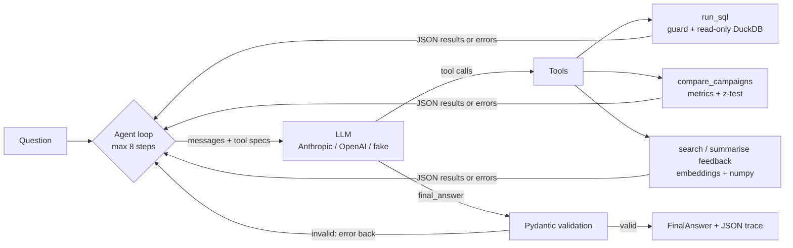

# Campaign Insights Agent

An LLM agent that answers marketing questions over a campaign database and a pile of customer feedback. It writes and runs SQL, compares campaigns with a significance test, searches feedback with embeddings, and returns a validated, structured answer with the SQL it used.

I built this because junior data science roles now ask for LLM agent skills (tool calling, structured outputs, embeddings, evaluation), and I wanted a project where I wrote each of those pieces myself and can explain why they work the way they do.

[](https://github.com/JoMatata/campaign-insights-agent/actions/workflows/ci.yml)

> **Data note:** all data is synthetic and seeded. "Tausi Foods" is a made-up Kenyan consumer brand (cooking oil, flour, snacks, juice) that sells online. No real company or customer data is used.

## What it does

- **Data:** a DuckDB database with 18 campaigns over six channels (Google Search, Meta, TikTok, YouTube, Display, X), 34,056 rows of daily performance by campaign, county and device (Jan to Jun 2026), 53 creatives, and 3,000 feedback snippets in English, Swahili and Sheng.
- **Agent tools:** `get_schema`, `run_sql` (read-only, guarded), `compare_campaigns` (CTR, CVR, CPA, ROAS plus a two-proportion z-test), `search_feedback` (embedding search) and `summarise_feedback_theme`.
- **Structured output:** the agent has to finish by calling `final_answer`, which is validated against a Pydantic model (`answer`, `key_numbers`, `sql_used`, `confidence`, `caveats`). If validation fails, the error goes back to the model and it tries again.
- **Text pipeline:** embeddings, KMeans clustering with silhouette-based k, cluster labels, and a topic classifier comparison on 300 labelled rows.
- **Evaluation:** 25 golden questions whose expected answers come from reference SQL, scored on numeric accuracy, whether the SQL runs, tool-call count and latency.
- **Interfaces:** a CLI, a small Streamlit page, and an MCP server so the same tools work from Claude Desktop.

## Quick demo

No API key was available when I wrote this README, so the output below is from the **scripted demo** (`make demo`). A fake LLM replays a fixed list of tool calls (including one SQL query with a deliberate typo), and the real tools run against the real database. The tool results and the numbers are real; the "reasoning" is scripted.

```
$ python -m src.cli demo
SCRIPTED DEMO: no model is called. Tool calls are replayed; results are real.
Q: Did TikTok Madaraka Day (C11) underperform Meta Madaraka Day (C10)? And what were customers
   complaining about at the end of May?

Steps:
  1. get_schema({}) -> ok [265 ms]
  2. run_sql({'query': 'SELECT campaign_id, sum(conversion) FROM daily_performance WHERE campa...'}) -> ERROR [1 ms]
     {"ok": false, "error": "BinderException: Binder Error: Referenced column \"conversion\" not found ...
  3. run_sql({'query': 'SELECT campaign_id, sum(conversions) FROM daily_performance WHERE camp...'}) -> ok [5 ms]
  3. compare_campaigns({'campaign_a': 'C10', 'campaign_b': 'C11'}) -> ok [4 ms]
  4. summarise_feedback_theme({'theme': 'M-Pesa payment failed, money deducted', 'k': 40,
     'start_date': '2026-05-25', 'end_date': '2026-06-01'}) -> ok [5587 ms]
  4. run_sql({'query': 'SELECT date, sum(conversions) AS conversions FROM daily_performance WH...'}) -> ok [7 ms]
  5. final_answer({}) -> ok [0 ms]

Answer (medium confidence):
  Yes. C11 (TikTok) converted 0.82% of clicks against 3.04% for C10 (Meta), a gap of 2.21 pp
  (p<0.001). ROAS was 1.23 vs 3.09. Conversions fell to 71 on 2026-05-28 against a median of 243
  per day that week. Feedback from 25 May to 1 June that is closest to payment failure is about:
  m-pesa, refund, payment, nililipa, nililipa double, double hakuna. Example: "so payment failed
  but m-pesa sent a confirmation message. please sort this out"

Key numbers:
  - C10 CVR: 3.04 %
  - C11 CVR: 0.82 %
  - C10 ROAS: 3.09 x
  - C11 ROAS: 1.23 x
  - Conversions on 2026-05-28: 71 count
```

The full JSON trace for this run is in [`reports/example_trace_scripted_demo.json`](reports/example_trace_scripted_demo.json). (The summarise step is slow because it loads the embedding model on first use.) With a key, `python -m src.cli ask "Which channel has the best ROAS?"` runs the same loop with Claude choosing the tools.

## How it works



| Folder | What is in it |
|---|---|
| `src/data/generate.py` | Seeded generator for the database and the labelled set |
| `src/agent/` | `llm.py` (provider interface, adapters, scripted fake), `tools.py`, `sql_guard.py`, `stats.py`, `loop.py`, `schemas.py` |
| `src/text/` | `embed.py` (MiniLM or TF-IDF fallback), `index.py`, `cluster.py`, `classify.py`, `pipeline.py` |
| `eval/` | `golden.py` (25 questions), `scoring.py`, `run_eval.py` |
| `src/cli.py`, `app/streamlit_app.py`, `src/mcp_server.py` | Interfaces |

The generator plants a few patterns for the agent to find: Search converts best and TikTok buys cheap clicks that rarely convert; desktop converts better than mobile; an M-Pesa outage on 28 and 29 May cuts conversions by about 70%, and payment complaints go from 13% of feedback to 43% on the days around it; Mombasa and Kisumu get more delivery complaints.

## Results

Embeddings for these results came from **sentence-transformers `all-MiniLM-L6-v2`**, which downloaded fine in my environment. I also ran the TF-IDF + SVD fallback so the two can be compared. Raw outputs are in `reports/text_results_*.json`.

**Clustering (3,000 snippets, KMeans, k chosen from 4 to 12 by cosine silhouette)**

| Embedder | Chosen k | Silhouette | Adjusted Rand vs true themes |
|---|---|---|---|
| all-MiniLM-L6-v2 | 10 | 0.199 | 0.216 |
| TF-IDF + SVD | 12 (edge of range) | 0.146 | 0.166 |

The silhouette scores are low, and the clusters don't line up neatly with the seven themes. Four of the ten MiniLM clusters are fairly clean (pricing 0.92 purity, ad annoyance 0.88, payment 0.79, delivery 0.78). The rest group by product ("chapati flour", "tea leaves") or by language: the largest cluster (619 snippets, purity 0.30) is mostly Swahili and Sheng text, whatever it is about. MiniLM was trained mainly on English, and you can see that here.

**Topic classification (300 labelled rows, 7 classes)**

| Method | Macro-F1 | Accuracy | Notes |
|---|---|---|---|
| Logistic regression on MiniLM embeddings (5-fold CV) | **0.894** | 0.897 | baseline |
| Zero-shot: cosine similarity to label descriptions (MiniLM) | 0.667 | 0.667 | no training data; "positive" F1 only 0.34 |
| Logistic regression on TF-IDF + SVD (5-fold CV) | 0.897 | 0.900 | fallback embedder |
| Zero-shot on TF-IDF + SVD | 0.690 | 0.683 | |
| LLM zero-shot classifier | not run | | needs `ANTHROPIC_API_KEY`; run `make text-llm` |

The labels come from the generator's ground truth (the theme each snippet was generated from), not from people. About 12% of snippets mention a second theme, so a perfect score is not possible. Even so, the 0.89 is optimistic. The text comes from templates, so the same template with different product names can end up in both the training and test folds. On real feedback I would expect lower numbers.

**Agent evaluation**

| Mode | Accuracy | SQL executes | Mean tool calls | Median latency |
|---|---|---|---|---|
| Claude (real model) | run `make eval` with your key | | | |
| Scripted replay (`make eval-fake`) | 25/25 | 25/25 | 2.0 | 14 ms |

The scripted replay only runs the reference SQL through the loop, so its 25/25 shows that the loop, the tools and the scorer work together. It says nothing about how good a model is, and I have not put any model numbers here because I have not run it with a key yet.

## Design decisions and trade-offs

- **Raw SDK tool-use loop instead of LangGraph or LangChain.** The loop is about 60 lines in `loop.py`. I can point at the exact place where tool results go back to the model, where validation happens and where the step cap stops it. A framework would add graph state, checkpoints and retries that this project doesn't need, and it would hide the part I wanted to learn. If I needed branching workflows or human approval steps, I would look at LangGraph.
- **Provider-agnostic interface.** The loop only sees `ToolCall`, `LLMResponse` and a neutral message format. The Anthropic and OpenAI adapters each translate to their own API in 30 to 40 lines. The same interface made the scripted fake easy to write, and that fake is what lets CI test the agent without a key.
- **Structured output through a `final_answer` tool.** The JSON schema comes straight from the Pydantic model, so the model sees the same contract the code validates against. This works the same way on both providers.
- **SQL guardrails in three layers.** The model writes the SQL, so I treat it as untrusted. (1) A keyword check allows only a single SELECT or WITH statement and blocks file-reading functions like `read_csv`. (2) The DuckDB connection is opened read-only with external access turned off, so even a query that gets past the check can't write anything or read files. (3) Every query is wrapped in an outer LIMIT, and a timer interrupts it after 10 seconds. Errors go back to the model as text, which is how it fixes a wrong column name.
- **Brute-force numpy search instead of a vector database.** 3,000 vectors × 384 dimensions is about 4.6 MB, and one dot product takes milliseconds. A vector DB would add a service to run for no gain at this size.
- **TF-IDF + SVD fallback.** It uses character n-grams, which cope with Sheng spellings and typos. It means the project runs and CI passes without downloading torch.
- **z-test with a warning.** With millions of impressions, almost any gap comes out "significant", so the tool returns the absolute difference and a confidence interval, plus a note telling the model to judge the size of the effect.
- **Golden answers come from SQL, not hard-coded numbers,** so they stay correct if the generator changes. Rates are accepted as either a fraction or a percentage, rounded to 0.1 percentage points.

## Limitations

- The data is synthetic, and the feedback text comes from templates. It's more varied than a toy set, but it's much more regular than real customer text.
- The z-test treats every impression as independent. Real ad data is clustered by day and audience, so these p-values come out too small. A bootstrap over days would be more honest.
- `summarise_feedback_theme` summarises the top-k most similar snippets. It is not a count of how often a theme occurs.
- MiniLM handles Swahili and Sheng poorly (see the clustering results).
- The keyword guard can reject a valid query, for example one that uses a column called `set`. I chose to be strict.
- The agent answers one question at a time and has no conversation memory.
- No real-model evaluation numbers yet.

## What I'd do next

1. Run `make eval` and `make text-llm` with a key, and report accuracy, cost and the questions the model gets wrong.
2. Try a multilingual embedding model (`paraphrase-multilingual-MiniLM-L12-v2`) and see whether the Swahili and Sheng cluster splits up by topic.
3. Hand-label a few hundred real-looking comments to get an honest classifier benchmark.
4. Replace the z-test in `compare_campaigns` with a day-level bootstrap.
5. Add prompt caching for the system prompt and tool specs, and track tokens per question in the eval.

## How to run

```bash
pip install -r requirements.txt              # core; uses the TF-IDF fallback
pip install -r requirements-optional.txt     # optional: sentence-transformers (torch), openai
cp .env.example .env                          # add ANTHROPIC_API_KEY if you have one

make data        # build data/campaigns.duckdb and data/labelled_feedback.csv
make text        # clustering + classifier comparison
make demo        # scripted agent run, no key needed
make eval-fake   # golden questions through the scripted replay
make test        # pytest (41 tests, fake LLM, no key)

make ask Q="Which channel had the best ROAS in March?"   # needs a key
make eval                                                  # needs a key
make app         # Streamlit page
make mcp         # MCP server over stdio
```

To use the tools from Claude Desktop, run `make data` first, then add this to `claude_desktop_config.json` (with your own paths):

```json
{"mcpServers": {"campaign-insights": {
  "command": "/path/to/python", "args": ["-m", "src.mcp_server"],
  "env": {"PYTHONPATH": "/path/to/campaign-insights-agent"}}}}
```

Tested with Python 3.13 locally. CI runs on 3.12 and 3.13.

## License

MIT. See [LICENSE](LICENSE).
